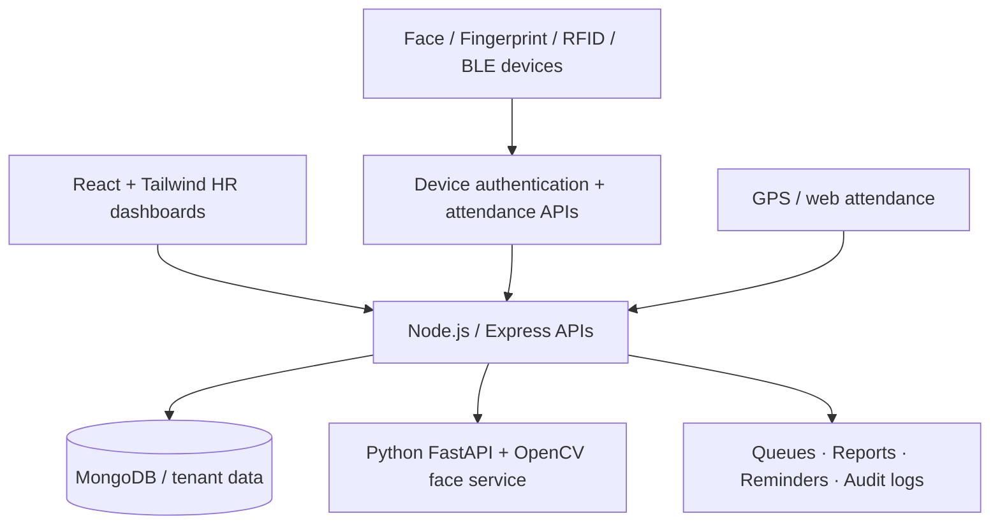

**Full-Stack Engineering · Embedded & IoT Systems · Product Architecture · Fintech**

## 👋 About Me

Hi, I'm **Viranch Gupta** (`@FinancialNoobster`) — a developer and product builder working at the intersection of **web software, physical devices, workforce technology, and finance**.

I design systems from end to end: **frontend interfaces → backend APIs → databases → authentication and permissions → connected hardware → diagnostics and deployment**. I also work hands-on with **Arduino/ESP32 programming, electronic components, communication protocols, and hardware system design**.

- 🏢 **Building Working Bridge:** an integrated, multi-tenant HR and workforce management platform with connected attendance hardware.
- 🔐 **Engineering interests:** authentication, access control, secure device identity, multi-tenant architecture, and API security.
- 🔧 **Hardware interests:** ESP32/ESP32-S3, Arduino-style C/C++, biometric devices, BLE, RFID, camera modules, TFT screens, and PCB/electronics prototyping.
- 📊 **Analytical approach:** interpreting operational data, designing business workflows, debugging system bottlenecks, and translating requirements into real products.
- 📈 **Beyond software:** fintech, business operations, and building practical tools for organizations.

---

## 🌉 Flagship Project: Working Bridge

> **A connected HR SaaS + attendance hardware ecosystem** — designed to bring workforce operations and physical check-in devices into one platform.

**My work spans product design, full-stack implementation, backend architecture, device integration, and security-aware workflows.** This is an independent product; the full proprietary codebase is not linked from this public profile.

### 🧩 HR platform & business workflows

| Area | What I designed / worked on |
| --- | --- |
| **Multi-role workspaces** | Platform Admin, Founder, HR, Manager, Employee, Freelancer, and delegated Work access |
| **Workforce operations** | Employee lifecycle, onboarding, departments, shifts, attendance, leave balances, holiday calendars, and correction requests |
| **Payroll & finance** | Payroll processing, salary slips, compensation revisions, staff finance, reimbursements, and gratuity workflows |
| **Work & people management** | Projects, tasks, work logs, reviews, recruitment, and approval workflows |
| **Operations & oversight** | Document/asset management, support tickets, notifications, scheduled reminders, reporting dashboards, and audit logs |
| **Commercial platform** | Tenant/company configuration, subscription/billing workflows, and payment integration |

### 🪪 Four types of attendance hardware

| Device / method | What it demonstrates |
| --- | --- |
| **📷 Face recognition terminal** | ESP32-S3 camera integration, TFT interface, image capture, backend recognition, and queued processing using Python/OpenCV |
| **👆 Fingerprint scanner** | Fingerprint device interfacing, enrollment/verification-oriented workflows, and attendance API integration |
| **💳 RFID / card scanner** | Card identifiers, device-to-employee assignments, and authenticated attendance events |
| **📶 Bluetooth attendance device** | BLE communication, browser-device interaction, device assignment, and provisioning flows |

**Also supported in the software:** GPS/location-based and website-based attendance. *Face and fingerprint are biometric methods; RFID and BLE are device-based attendance methods.*

### 🛡️ Security & architecture

- **Identity and access:** JWT-based authentication, HttpOnly authentication cookies, role-based permissions, and scoped dashboards.
- **Web/API protections:** CSRF checks, request validation, CORS configuration, rate limiting, security headers, and audit trails.
- **Device trust:** per-device credentials, hashing/encryption of sensitive device information, and tenant/device association.
- **Provisioning:** factory inventory, device activation claims, and encrypted BLE provisioning workflows.
- **Reliability:** background job queues for face scans, retries, asynchronous email/reminder workers, and diagnostic troubleshooting.
- **Computer vision:** a separate **Python + FastAPI + OpenCV** service using YuNet/SFace components for face detection/recognition.

### 🏗️ How the system fits together

*Architecture is a high-level view of the application, not a public deployment or security-certification claim.*

---

## 🛠️ Tech Stack

**Web, UI & Applications**

**Backend, Data & Computer Vision**

**Embedded Systems & Connected Hardware**

**Engineering & Delivery**

## 🧠 What I Bring to Engineering Projects

| Strength | Example of work |
| --- | --- |
| **Full-stack product development** | Building complete React/Express/MongoDB applications instead of isolated screens |
| **Hardware + software integration** | Connecting microcontrollers, sensors/readers, displays, BLE, and HTTP APIs |
| **System design** | Planning device identity, service boundaries, data models, queues, and multi-tenant workflows |
| **Application security** | Designing login, permissions, device authorization, CSRF defenses, and credential handling |
| **Data & business analysis** | Translating HR/payroll/attendance requirements into reports, rules, and actionable workflows |
| **Debugging & optimization** | Investigating network delays, failed requests, embedded constraints, and backend job reliability |

## 🚀 Other Projects

| Project | Focus | Link |
| --- | --- | --- |
| **Money-Mediia** | MERN-based employee management, payroll/leave features, and authentication | [Repository](https://github.com/FinancialNoobster/Money-Mediia) |
| **MAD 2 – Placement Portal** | Placement application, Vue frontend, and backend workflows | [Repository](https://github.com/FinancialNoobster/Mad_2_Placement-Portal-Application) |
| **MAD 1 – Placement Portal** | Placement-management application | [Repository](https://github.com/FinancialNoobster/Mad_1_Placement-Portal-Application) |
| **Backend Hardware Testing** | Experiments connecting backend services with physical devices | [Repository](https://github.com/FinancialNoobster/Backend-Hardware-Testing) |

---

## 📊 GitHub Statistics

## 🏆 GitHub Trophies

## 📈 Contribution Activity

## 🤝 Connect

**Building products that connect people, software, and hardware.** ⚡

<!-- Dynamic stats, streaks, and trophies are provided by third-party services and may occasionally be unavailable. -->
