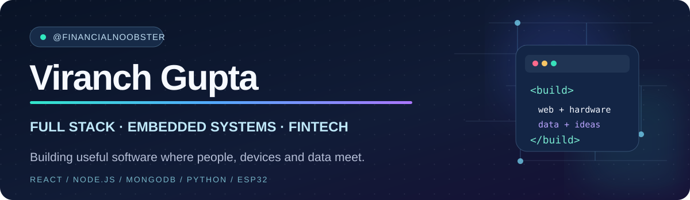
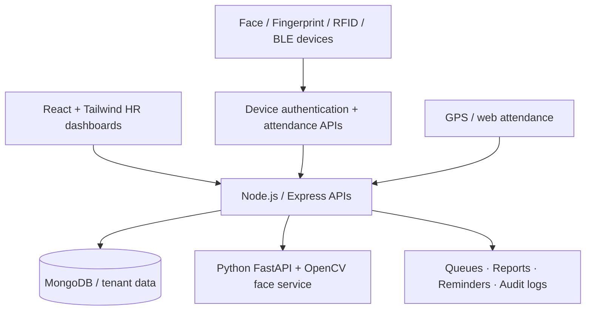

# Viranch Gupta

**Full-Stack Developer · Embedded Systems Builder · HR Technology**

**Full-Stack Engineering · Embedded & IoT Systems · Product Architecture · Fintech**

## 👋 About Me

Hi, I'm **Viranch Gupta** (`@FinancialNoobster`) — a developer and product builder working at the intersection of **web software, physical devices, workforce technology, and finance**.

I design systems from end to end: **frontend interfaces → backend APIs → databases → authentication and permissions → connected hardware → diagnostics and deployment**. I also work hands-on with **Arduino/ESP32 programming, electronic components, communication protocols, and hardware system design**.

- 🏢 **Building Working Bridge:** an integrated, multi-tenant HR and workforce management platform with connected attendance hardware.
- 🔐 **Engineering interests:** authentication, access control, secure device identity, multi-tenant architecture, and API security.
- 🔧 **Hardware interests:** ESP32/ESP32-S3, Arduino-style C/C++, biometric devices, BLE, RFID, camera modules, TFT screens, and PCB/electronics prototyping.
- 📊 **Analytical approach:** interpreting operational data, designing business workflows, debugging system bottlenecks, and translating requirements into real products.
- 📈 **Beyond software:** fintech, business operations, and building practical tools for organizations.

---

## 🌉 Flagship Project: Working Bridge

> **A connected HR SaaS + attendance hardware ecosystem** — designed to bring workforce operations and physical check-in devices into one platform.

**My work spans product design, full-stack implementation, backend architecture, device integration, and security-aware workflows.** This is an independent product; the full proprietary codebase is not linked from this public profile.

### 🧩 HR platform & business workflows

| Area | What I designed / worked on |
| --- | --- |
| **Multi-role workspaces** | Platform Admin, Founder, HR, Manager, Employee, Freelancer, and delegated Work access |
| **Workforce operations** | Employee lifecycle, onboarding, departments, shifts, attendance, leave balances, holiday calendars, and correction requests |
| **Payroll & finance** | Payroll processing, salary slips, compensation revisions, staff finance, reimbursements, and gratuity workflows |
| **Work & people management** | Projects, tasks, work logs, reviews, recruitment, and approval workflows |
| **Operations & oversight** | Document/asset management, support tickets, notifications, scheduled reminders, reporting dashboards, and audit logs |
| **Commercial platform** | Tenant/company configuration, subscription/billing workflows, and payment integration |

### 🪪 Four types of attendance hardware

| Device / method | What it demonstrates |
| --- | --- |
| **📷 Face recognition terminal** | ESP32-S3 camera integration, TFT interface, image capture, backend recognition, and queued processing using Python/OpenCV |
| **👆 Fingerprint scanner** | Fingerprint device interfacing, enrollment/verification-oriented workflows, and attendance API integration |
| **💳 RFID / card scanner** | Card identifiers, device-to-employee assignments, and authenticated attendance events |
| **📶 Bluetooth attendance device** | BLE communication, browser-device interaction, device assignment, and provisioning flows |

**Also supported in the software:** GPS/location-based and website-based attendance. *Face and fingerprint are biometric methods; RFID and BLE are device-based attendance methods.*

### 🛡️ Security & architecture

- **Identity and access:** JWT-based authentication, HttpOnly authentication cookies, role-based permissions, and scoped dashboards.
- **Web/API protections:** CSRF checks, request validation, CORS configuration, rate limiting, security headers, and audit trails.
- **Device trust:** per-device credentials, hashing/encryption of sensitive device information, and tenant/device association.
- **Provisioning:** factory inventory, device activation claims, and encrypted BLE provisioning workflows.
- **Reliability:** background job queues for face scans, retries, asynchronous email/reminder workers, and diagnostic troubleshooting.
- **Computer vision:** a separate **Python + FastAPI + OpenCV** service using YuNet/SFace components for face detection/recognition.

### 🏗️ How the system fits together

*Architecture is a high-level view of the application, not a public deployment or security-certification claim.*

---

## 🛠️ Tech Stack

**Web, UI & Applications**

`JavaScript`
`React`
`Vue.js`
`HTML5`
`CSS3`
`Tailwind CSS`

**Backend, Data & Computer Vision**

`Node.js`
`Express`
`MongoDB`
`Python`
`FastAPI`
`Flask`
`OpenCV`

**Embedded Systems & Connected Hardware**

`Arduino`
`ESP32 / ESP32-S3`
`C++`
`BLE`
`IoT`
`RFID`
`SPI | I2C | UART`

**Engineering & Delivery**

`Git`
`GitHub`
`REST APIs`
`JWT`
`Vercel`
`Render`

## 🧠 What I Bring to Engineering Projects

| Strength | Example of work |
| --- | --- |
| **Full-stack product development** | Building complete React/Express/MongoDB applications instead of isolated screens |
| **Hardware + software integration** | Connecting microcontrollers, sensors/readers, displays, BLE, and HTTP APIs |
| **System design** | Planning device identity, service boundaries, data models, queues, and multi-tenant workflows |
| **Application security** | Designing login, permissions, device authorization, CSRF defenses, and credential handling |
| **Data & business analysis** | Translating HR/payroll/attendance requirements into reports, rules, and actionable workflows |
| **Debugging & optimization** | Investigating network delays, failed requests, embedded constraints, and backend job reliability |

## 🚀 Projects & GitHub Activity

My public projects, languages, milestones and activity are discovered automatically from GitHub below.

---

## 📊 Live GitHub Dashboard

<!-- LIVE_GITHUB_START -->
Data last changed: **18 Nov 2026, 00:59 UTC** · GitHub API · refresh checked hourly (not instant)

### 📌 GitHub at a glance

| Public repositories | Stars on my projects | Forks of my projects | Followers | Following |
| :---: | :---: | :---: | :---: | :---: |
| **8** | **2** | **0** | **10** | **13** |

### 🔥 Contributions and streaks

| Past-year contributions | Current streak | Longest streak (past year) | Tracked yearly contributions |
| :---: | :---: | :---: | :---: |
| **139** | **0 days** | **15 days** | **147** |

*GitHub GraphQL contributions; streaks use UTC days and are calculated from the past-year calendar.*

#### Contributions by calendar year

| Year | Contributions |
| --- | ---: |
| **2026** | **135** |
| **2025** | **4** |
| **2024** | **7** |
| **2023** | **0** |
| **2022** | **1** |

#### 📈 Weekly contribution activity (text chart)

| Week of (UTC) | Contributions | Relative activity |
| --- | ---: | --- |
| 15 Nov 2026 | **22** | `██████████████` |
| 08 Nov 2026 | **9** | `██████░░░░░░░░` |
| 01 Nov 2026 | **0** | `░░░░░░░░░░░░░░` |
| 25 Oct 2026 | **0** | `░░░░░░░░░░░░░░` |
| 18 Oct 2026 | **0** | `░░░░░░░░░░░░░░` |
| 11 Oct 2026 | **0** | `░░░░░░░░░░░░░░` |
| 04 Oct 2026 | **0** | `░░░░░░░░░░░░░░` |
| 27 Sep 2026 | **5** | `███░░░░░░░░░░░` |
| 20 Sep 2026 | **6** | `████░░░░░░░░░░` |
| 13 Sep 2026 | **2** | `█░░░░░░░░░░░░░` |
| 06 Sep 2026 | **0** | `░░░░░░░░░░░░░░` |
| 30 Aug 2026 | **0** | `░░░░░░░░░░░░░░` |

*Bars are scaled relative to the busiest week shown.*

### 💻 Repository languages

| Language | Share of code bytes | Relative share |
| --- | ---: | --- |
| **JavaScript** | 39.4% | `████░░░░░░` |
| **HTML** | 22.1% | `██░░░░░░░░` |
| **Vue** | 17.8% | `██░░░░░░░░` |
| **Python** | 14.0% | `█░░░░░░░░░` |
| **CSS** | 6.7% | `█░░░░░░░░░` |

*GitHub-reported code bytes across original public repositories; this profile repository and forks are excluded. Not a measure of developer proficiency.*

### 🚀 Recently updated public projects

| Repository | Primary language | Stars | Last push (UTC) |
| --- | --- | ---: | --- |
| [Money-Mediia](https://github.com/FinancialNoobster/Money-Mediia) | JavaScript | 1 | 2026-04-04 |
| [Backend-Hardware-Testing](https://github.com/FinancialNoobster/Backend-Hardware-Testing) | JavaScript | 0 | 2026-04-02 |
| [Mad_2_Placement-Portal-Application](https://github.com/FinancialNoobster/Mad_2_Placement-Portal-Application) | Vue | 0 | 2026-03-11 |
| [Mad_1_Placement-Portal-Application](https://github.com/FinancialNoobster/Mad_1_Placement-Portal-Application) | HTML | 1 | 2026-03-11 |
| [GFG_Task_1_HTML-CSS](https://github.com/FinancialNoobster/GFG_Task_1_HTML-CSS) | HTML | 0 | 2025-11-16 |
| [Vittashastra](https://github.com/FinancialNoobster/Vittashastra) | HTML | 0 | 2024-04-03 |

### ⭐ Most-starred public repositories

| Repository | Stars | Description |
| --- | ---: | --- |
| [Money-Mediia](https://github.com/FinancialNoobster/Money-Mediia) | 1 | Making Employee Manegment Software for Money Mediia. |
| [Mad_1_Placement-Portal-Application](https://github.com/FinancialNoobster/Mad_1_Placement-Portal-Application) | 1 | Mad 1 Project by 23f2003605 for Jan 2026 Term |
| [Backend-Hardware-Testing](https://github.com/FinancialNoobster/Backend-Hardware-Testing) | 0 | Public repository |
| [Mad_2_Placement-Portal-Application](https://github.com/FinancialNoobster/Mad_2_Placement-Portal-Application) | 0 | Mad 2 Project by 23f2003605 for Jan 2026 Term |
| [GFG_Task_1_HTML-CSS](https://github.com/FinancialNoobster/GFG_Task_1_HTML-CSS) | 0 | This is the first task by GFG Full Stact Web Development Course. |

### 📌 Repositories pinned on my GitHub profile

| Repository | Stars | Description |
| --- | ---: | --- |
| [Money-Mediia](https://github.com/FinancialNoobster/Money-Mediia) | 1 | Making Employee Manegment Software for Money Mediia. |
| [Mad_1_Placement-Portal-Application](https://github.com/FinancialNoobster/Mad_1_Placement-Portal-Application) | 1 | Mad 1 Project by 23f2003605 for Jan 2026 Term |
| [Vittashastra](https://github.com/FinancialNoobster/Vittashastra) | 0 | HTML |
| [Backend-Hardware-Testing](https://github.com/FinancialNoobster/Backend-Hardware-Testing) | 0 | JavaScript |
| [Mad_2_Placement-Portal-Application](https://github.com/FinancialNoobster/Mad_2_Placement-Portal-Application) | 0 | Mad 2 Project by 23f2003605 for Jan 2026 Term |

### 🏆 Personal progress milestones (not official GitHub trophies)

| Metric | Current | Next goal |
| --- | ---: | ---: |
| Past-year contributions | **139** | 250 |
| Public repositories | **8** | 10 |
| Stars earned | **2** | 5 |
| Followers | **10** | 25 |

<!-- DATA_HASH:ffb2b365443cce84376790d66bcd1d6acc2aebf8f28054225059c169fb4fe524 -->
<!-- LIVE_GITHUB_END -->

## 🤝 Connect

[GitHub](https://github.com/FinancialNoobster) · [LinkedIn](https://www.linkedin.com/in/viranch-gupta-99667b18b)

**Building products that connect people, software, and hardware.** ⚡

<!-- Public GitHub statistics and activities are generated as Markdown by the hourly workflow. -->
